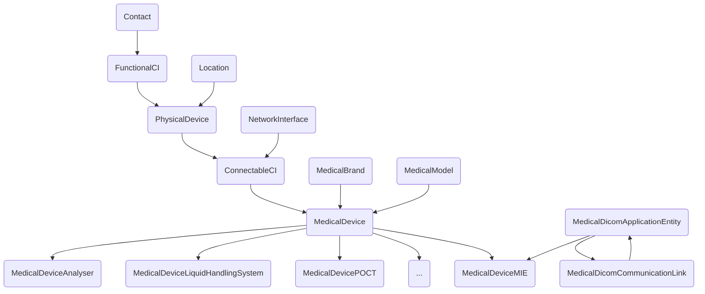

# iTop-br-medicaldevice

Copyright (c) 2024-2026 Björn Rudner

## What?

This extension adds structured management for **medical devices** in iTop. It introduces specific classes and attributes to support laboratory and clinical equipment, including model hierarchy and type classification.

- [DICOM Governance and Usage](docs/DICOM.md)

## Core entities

- **MedicalBrand**: Manufacturer / brand (e.g. Siemens, Roche)
- **MedicalModel**: Model name and type (e.g. Centrifuge, Incubator, Analyzer, Medical Imaging Equipment)
- **MedicalDevice**: Individual device instance with standard CMDB relations (location, contacts, contracts, network, etc.)
- **MedicalDicomApplicationEntity**: DICOM AE (Application Entity), including modality/role and technical endpoint data
- **MedicalDicomCommunicationLink**: Governed communication relationship between two DICOM AEs (source/target) with lifecycle status

### Subclasses of `MedicalDevice`

- `MedicalDeviceAnalyser`
- `MedicalDeviceCentrifuge`
- `MedicalDeviceIncubator`
- `MedicalDeviceLiquidHandlingSystem`
- `MedicalDeviceMicroscope`
- `MedicalDeviceMIE`
- `MedicalDevicePOCT`
- `MedicalDeviceRefrigerator`
- `MedicalDeviceSafetyCabinet`
- `MedicalDeviceSamplePreparation`
- `MedicalDeviceTubeSorter`

Each subclass inherits from `ConnectableCI` and supports standard CMDB relationships (location, contracts, contacts, network interfaces, etc.).

## Features

- Separate typologies for **brand** and **model**
- Device-to-model relation
- Optional model filtering based on device class
- DICOM AE documentation for medical imaging equipment (MIE)
- Governed DICOM communication links (source/target, direction, lifecycle status)
- Validation rules for DICOM links (e.g. source != target; basic SCU/SCP role compatibility)
- Full integration with iTop CMDB ecosystem
- Easy extension for additional device types (XML)

## Relations

## Installation

This branch requires **iTop 3.3.0 or later**.

| Required module             | Minimum version | Used for                                              |
| --------------------------- | --------------- | ----------------------------------------------------- |
| `itop-structure`            | 3.3.0           | Organizations, typologies, and documents              |
| `itop-config-mgmt`          | 3.3.0           | Connectable devices and network interfaces            |
| `itop-bridge-cmdb-services` | 3.3.0           | Service and provider contract tabs on medical devices |
| `teemip-ip-mgmt`            | 3.3.1           | IP addresses for DICOM application entities           |

1. Make TeemIP Core IP Management and this extension available in the iTop `extensions/` directory.
2. Run iTop setup with Configuration Management and either Service Management option to include the CMDB and Services bridge.
3. Select TeemIP IP Management and **Datamodel: Medical Devices**, then complete setup.

With iTop Flow Management enabled, the optional [DICOM flow bridge](docs/DICOM.md#dicom-data-flows) maps DICOM approvals onto the native CI flow map.

For a working example, choose demo data during installation and open the CT-to-PACS link
in the **Demo Radiology** organization. [CT and PACS example](docs/DICOM.md#installed-ct-and-pacs-example)

## Development

- [Local tests and XML schema validation](tests/README.md)
- [Release preparation and packaging](scripts/README.md)

## Status

This extension is under active development. Feedback and contributions are welcome.

## iTop Compatibility

| iTop version | Extension branch               |
| ------------ | ------------------------------ |
| 3.3          | [main][itop-main] (from 3.3.0) |
| 3.2          | [itop/3.2][itop-32]            |
| 2.7 or 3.1   | [itop/2.7][itop-27]            |

[itop-main]: https://github.com/rudnerbjoern/iTop-br-medicaldevice/tree/main
[itop-32]: https://github.com/rudnerbjoern/iTop-br-medicaldevice/tree/itop/3.2
[itop-27]: https://github.com/rudnerbjoern/iTop-br-medicaldevice/tree/itop/2.7

The 3.3 series has been tested on iTop 3.3.0. Earlier versions were tested on iTop 2.7.10 and 3.2.2.
